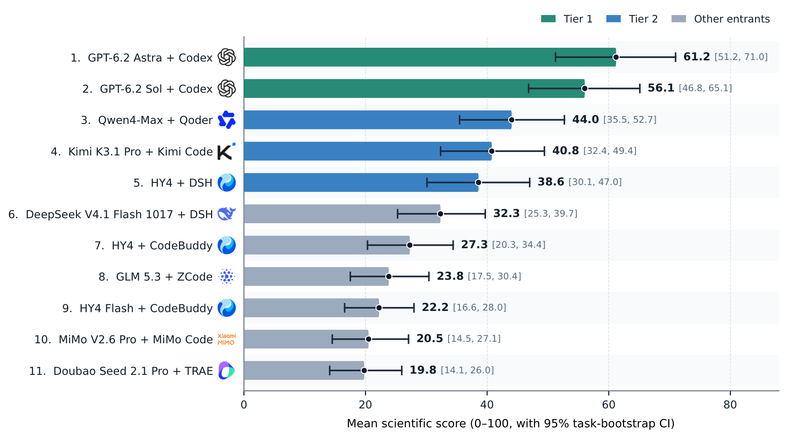
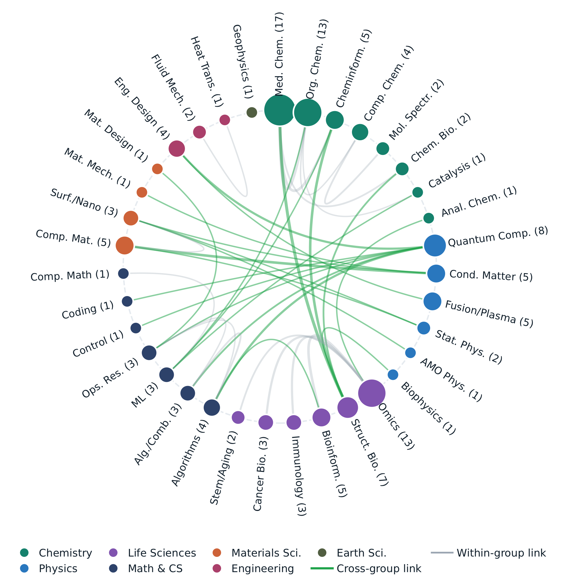
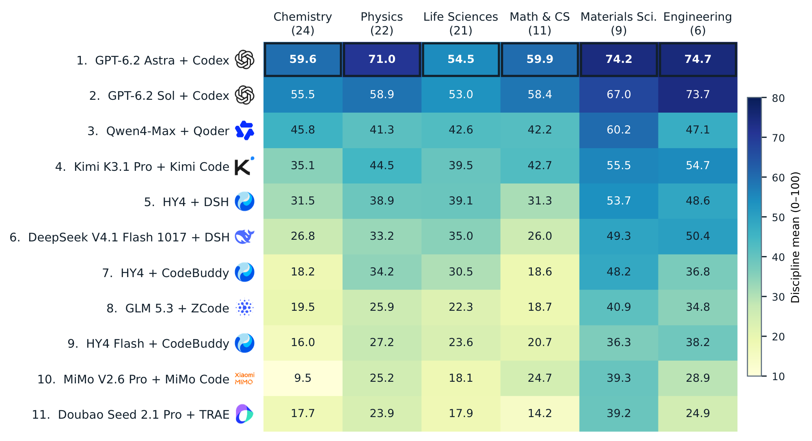
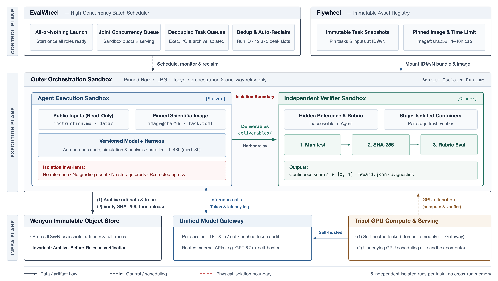

<div align="center">

<a href="https://deltascience.bohrium.com/">
  
</a>

<h3>An Open Evaluation Platform for Large Models and AI Agents in Real Scientific Scenarios</h3>

<p>
  <em>Real problems. Scientific rigor. Turning AI progress into scientific progress.</em>
</p>

<p>
  <a href="https://deltascience.bohrium.com/"></a>
  <a href="https://play.bohrium.com/competition/science-pilot"></a>
  <a href="./tasks/README.md"></a>
  <a href="mailto:deltascience@aisi.ac.cn"></a>
</p>

<p>
  <strong>English</strong> | <a href="./README_zh.md">简体中文</a>
</p>

</div>

---

## Overview

**DeltaScience** is an **open evaluation platform for large models and AI agents in real scientific scenarios**, dedicated to **connecting frontier scientific discovery with real-world industrial R&D, and testing AI scientific capability on problems that truly matter**.

The symbol **$\delta$** in DeltaScience carries a dual meaning: it represents a **verifiable, retestable scientific capability increment**, and it embodies the **continuous evolution** of both the benchmark and AI scientific capability. Rather than testing isolated multiple-choice recall or synthetic coding puzzles, DeltaScience evaluates complete **Model + Harness** systems inside isolated scientific sandboxes—where every submission must produce reproducible code, numerical fields, molecular candidates, or multi-stage analyses graded against strict physical, chemical, biological, or engineering acceptance criteria.

> **Non-Profit & Public-Interest Commitment**: DeltaScience is a **non-profit**, public-interest scientific evaluation initiative. Private benchmark task sets are never sold, commercially transferred, or used for model training.

### Key Highlights of DeltaScience v1.0

- **65 Private Real-World Scientific Tasks**: Curated from frontline university research groups and industrial R&D teams across **7 discipline groups**, **35 subfields**, and **4 mutually exclusive task types**, with **29 tasks (44.6%)** spanning two or more discipline groups.
- **Rigorous 5-Trial Isolated Evaluation**: **11 versioned Model + Harness configurations** evaluated over **5 independent trials per task** (**3,575 official runs**; over 10,000 total sandbox runs including pre-checks and controlled re-evaluations), with per-task time limits ranging from **1h to 48h** (median **8h**).
- **CSTR Persistent Identifiers**: Every accepted DeltaScience task is assigned a globally unique, long-term citable **Common Science and Technology Resource (CSTR)** persistent identifier operated by the Computer Network Information Center (CNIC), Chinese Academy of Sciences under China's national standard *Science and Technology Resource Identifier*.
- **Dual-Track Continuous Evolution**: Released versions (such as `v1.0`) remain version-locked (`ID@vN`) so teams can retest improvements on the exact same task set to measure genuine scientific increment $\delta$, while new tasks are admitted through monthly versioned releases and saturated tasks are progressively open-sourced to the community.

---

## Official Evaluation Platform & Resources

| Resource | Link | Description |
| :--- | :--- | :--- |
| **Official Platform & Leaderboard** | [https://deltascience.bohrium.com/](https://deltascience.bohrium.com/) | Live v1.0 leaderboard, per-discipline breakdowns, public exemplar tasks, and evaluation registration |
| **Year-Round Task Authoring Competition** | [https://play.bohrium.com/competition/science-pilot](https://play.bohrium.com/competition/science-pilot) | Submit real scientific problems for batch domain-expert review, CSTR attribution, collective authorship, and community incentives |
| **Open-Source Task Repository** | [https://github.com/deepmodeling/DeltaScience](https://github.com/deepmodeling/DeltaScience) | Open-source representative Harbor task packages, specifications, and verification contracts |
| **Official Contact** | [deltascience@aisi.ac.cn](mailto:deltascience@aisi.ac.cn) | Evaluation onboarding for Model + Harness teams, institutional collaboration, and community inquiries |

---

## Open-Source Representative Tasks

To prevent data contamination, the full 65-task v1.0 benchmark stays private during its active evaluation window. In this repository, we open-source **7 representative high-quality tasks** covering the core domains of DeltaScience v1.0 so researchers and task authors can inspect the Harbor task format, scientific acceptance rubrics, and containerized verification pipeline.

| CSTR Identifier | Discipline Group(s) | Scientific Topic | Task Type | Limit | Task Package | Web Page |
| :--- | :--- | :--- | :--- | :---: | :---: | :---: |
| [`31254.49.DELTASCIENCE.V1.C.03`](https://cstr.cn/31254.49.DELTASCIENCE.V1.C.03) | Chemistry, Life Sciences | **BCL2 / BCL-XL Selective Molecular Design**: diverse ligand sets prioritizing BCL2 selectivity | Open Design & Search | 5h | [Open](./tasks/C-03/) | [View](https://deltascience.bohrium.com/questions/C-03) |
| [`31254.49.DELTASCIENCE.V1.R.DAN.12`](https://cstr.cn/31254.49.DELTASCIENCE.V1.R.DAN.12) | Chemistry | **Danicopan Series (`DAN-US2019-EX395`)**: open-route retrosynthesis & multi-route ranking | Tool-Use & Planning | 8h | [Open](./tasks/R-DAN-12/) | [View](https://deltascience.bohrium.com/questions/R-DAN-12) |
| [`31254.49.DELTASCIENCE.V1.O03`](https://cstr.cn/31254.49.DELTASCIENCE.V1.O03) | Life Sciences | **Prurigo Nodularis Fibroblast Pathology**: 9-stage cross-cohort discovery & multi-omics validation | Multi-Stage Analysis | 8h | [Open](./tasks/O03/) | [View](https://deltascience.bohrium.com/questions/O03) |
| [`31254.49.DELTASCIENCE.V1.QI.0002`](https://cstr.cn/31254.49.DELTASCIENCE.V1.QI.0002) | Physics, Math & CS | **Noise-Adapted Quantum Error Correction**: gate-error tolerance optimization for constrained encoder/decoder circuits | Open Design & Search | 12h | [Open](./tasks/QI-0002/) | [View](https://deltascience.bohrium.com/questions/QI-0002) |
| [`31254.49.DELTASCIENCE.V1.FUS.0001`](https://cstr.cn/31254.49.DELTASCIENCE.V1.FUS.0001) | Physics | **Tokamak Free-Boundary Equilibrium Optimization**: MAST-U discharge 45425 across 212 time slices | Simulation & Comp. | 4h | [Open](./tasks/FUS-0001/) | [View](https://deltascience.bohrium.com/questions/FUS-0001) |
| [`31254.49.DELTASCIENCE.V1.T14`](https://cstr.cn/31254.49.DELTASCIENCE.V1.T14) | Materials Science, Math & CS | **Robust Selective Release Optimization**: joint discrete trap orientation & continuous process control | Open Design & Search | 1h | [Open](./tasks/T14/) | [View](https://deltascience.bohrium.com/questions/T14) |
| [`31254.49.DELTASCIENCE.V1.LH.1`](https://cstr.cn/31254.49.DELTASCIENCE.V1.LH.1) | Physics | **Stellarator Quasi-Axisymmetric Boundary Optimization** (`PRECISE_QA`): multi-constraint magnetic confinement | Open Design & Search | 24h | [Open](./tasks/LH-1/) | [View](https://deltascience.bohrium.com/questions/LH-1) |

See [`tasks/README.md`](./tasks/README.md) for the standard Harbor task directory layout (`instruction.md`, `task.toml`, `environment/`, `tests/`, `solution/`).

---

## DeltaScience v1.0 Leaderboard & Key Findings

All 11 versioned **Model + Harness** configurations were evaluated across all **65 private tasks × 5 independent trials** (**3,575 runs**). Task scores are averaged over the 5 trials and then macro-averaged equally across all 65 tasks, with 95% confidence intervals computed via 5,000 paired task-level bootstrap resamples. Timeouts, refusals, and harness errors are scored as 0.

| Rank | Model + Harness | Mean Score | 95% CI | pass@5 | pass⁵ | Median Time |
| :---: | :--- | :---: | :---: | :---: | :---: | :---: |
| 1 | **GPT-6.2 Astra + Codex** | **61.2** | [51.2, 70.6] | 44.6% | 30.8% | 42m |
| 2 | **GPT-6.2 Sol + Codex** | **56.1** | [46.8, 65.1] | 36.9% | 21.5% | 35m |
| 3 | **Qwen4-Max + Qoder** | **44.0** | [35.2, 52.9] | 38.5% | 13.8% | 176m |
| 4 | **Kimi K3.1 Pro + Kimi Code** | **40.8** | [32.4, 49.3] | 34.4% | 12.5% | 150m |
| 5 | **HY4 + DSH** | **38.6** | [30.2, 47.2] | 36.9% | 4.6% | 148m |
| 6 | DeepSeek V4.1 Flash 1017 + DSH | 32.3 | [25.1, 39.9] | 32.3% | 3.1% | 191m |
| 7 | HY4 + CodeBuddy | 27.3 | [20.5, 34.8] | 26.2% | 4.6% | 172m |
| 8 | GLM 5.3 + ZCode | 23.8 | [17.4, 30.4] | 24.6% | 3.1% | 300m |
| 9 | HY4 Flash + CodeBuddy | 22.2 | [16.5, 28.4] | 18.5% | 1.5% | 114m |
| 10 | MiMo V2.6 Pro + MiMo Code | 20.5 | [14.3, 27.1] | 13.8% | 3.1% | 159m |
| 11 | Doubao Seed 2.1 Pro + TRAE | 19.8 | [14.0, 26.1] | 18.5% | 1.5% | 300m |

<p align="center">
  
</p>

### Empirical Takeaways

1. **Significant Headroom Remains**: Even the #1 system (`GPT-6.2 Astra + Codex`, 61.2) leaves nearly 40% headroom before reliably passing scientific acceptance across all 65 tasks, and **6 frontier tasks remain universally unsolved (0 across all 11 systems)**.
2. **Harness Engineering Matters as Much as the Base Model**: In controlled same-model comparisons, swapping the harness on `HY4` from `CodeBuddy` to `DSH` yields **+11.3 points** (95% CI `[+6.8, +15.9]`, 42/10 win-loss)—larger than swapping base models within a fixed harness.
3. **Reliability Gap (`pass@5` vs. `pass⁵`)**: Across all task × system cells, **70.4%** never achieve a full score in 5 trials and only **9.1%** pass all 5 trials consistently.
4. **Domain & Task-Type Specialization**: `Qwen4-Max + Qoder` leads **Tool-Use & Planning** (41.8 vs. 34.1–36.4 for GPT-6.2), while the Best-of-11 Oracle reaches **69.6** (+8.4 over #1).
5. **Code Execution ≠ Scientific Validity**: Among all zero-score trajectories, **61.4%** executed code cleanly without runtime errors yet failed physical, numerical, or domain acceptance criteria; longer runtimes correlate negatively with score (Spearman $\rho = -0.56$).

<p align="center">
  
  &nbsp;&nbsp;
  
</p>

---

## Governance & Evaluation Infrastructure

### Three-Layer Decoupled Governance Architecture

To safeguard academic neutrality while scaling task curation and compute execution, DeltaScience separates governance into three independent layers:

1. **DeltaScience Benchmark** *(Standards & Versioned Releases)*: Led by the **AI for Science Institute, Beijing**, operating on a non-profit, academically neutral basis to define scientific acceptance criteria, oversee batch domain-expert review, and publish fixed benchmark releases.
2. **Playground** *(Community Task Curation & Incentives)*: Hosts the year-round open task submission portal and authoring competition ([play.bohrium.com/competition/science-pilot](https://play.bohrium.com/competition/science-pilot)), automated pre-checks, and community incentives.
3. **Bohrium** *(Compute & Isolated Sandbox Execution)*: Provides GPU/CPU compute resources, isolated sandbox infrastructure, and technical operations without influencing task admission decisions.

### Reproducible Sandbox Stack

- **Flywheel**: Immutable versioned task bundles (`ID@vN`) with cryptographic artifact manifests.
- **EvalWheel**: High-concurrency sandbox scheduler (peak reservation of **12,375 sandbox slots**) managing three-tier isolation per run—orchestration sandbox, Agent execution sandbox, and an independent Verifier sandbox with zero visibility into reference solutions or grading scripts.
- **Wenyon**: Immutable object store archiving all deliverables, logs, SHA-256 digests, and full execution traces prior to container teardown.
- **Trisol**: Underlying GPU compute and model-serving platform powering both unified model inference and sandbox GPU execution.

<p align="center">
  
</p>

---

## How to Participate

- **Submit Scientific Tasks**: Bring real research or industrial R&D problems to the benchmark via the [Playground Authoring Competition](https://play.bohrium.com/competition/science-pilot). Accepted tasks receive a **CSTR persistent identifier**, collective authorship credit, citable records, and competition incentives.
- **Evaluate Your Model + Harness**: Register at [deltascience.bohrium.com](https://deltascience.bohrium.com/) or contact [deltascience@aisi.ac.cn](mailto:deltascience@aisi.ac.cn) to run isolated evaluations, receive task-level diagnostic feedback across scientific knowledge, tool use, and domain judgment, and schedule controlled retests on fixed task versions.
- **Explore & Reproduce**: Inspect the 7 open-source tasks in [`./tasks/`](./tasks/) and browse interactive results and public exemplar trajectories on [deltascience.bohrium.com](https://deltascience.bohrium.com/).

---

## Co-Building Institutions

- AI for Science Institute, Beijing
- DP Technology
- Zhejiang University
- University of Tokyo
- University of Cambridge
- Institute of Physics, Chinese Academy of Sciences
- Beihang University

---

## Usage Policy & Anti-Contamination Notice

- **Strictly No Training or Contamination**: No organization or individual may use DeltaScience benchmark tasks—including open-source representative tasks, problem statements, reference solutions, or grading scripts, as well as any paraphrases, translations, or derived variants—to **train, fine-tune, or distill any model, or to generate synthetic training data**. Bulk scraping, commercial resale, or for-profit redistribution is strictly prohibited.
- **Leaderboard Interpretation**: Published scores reflect finite-trial evaluation outcomes for specific models under specific harnesses, parameter settings, runtime environments, and timestamps. Given the stochasticity of large models and agents, leaderboard results do not constitute commercial endorsements.

---

## Citation

If you reference DeltaScience, its leaderboard, or any open-source tasks in your work, please cite:

```bibtex
@techreport{deltascience2026,
  title       = {DeltaScience: Benchmarking AI Agents on Real Scientific Problems},
  author      = {{DeltaScience Team}},
  institution = {AI for Science Institute, Beijing},
  year        = {2026},
  month       = {November},
  url         = {https://deltascience.bohrium.com/}
}
```
