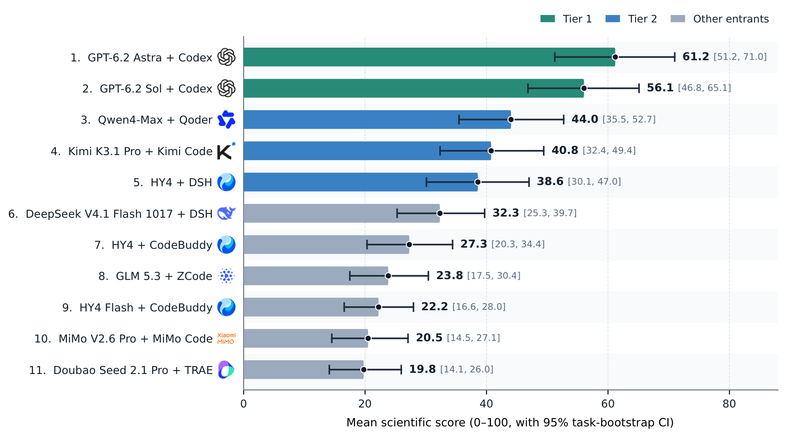
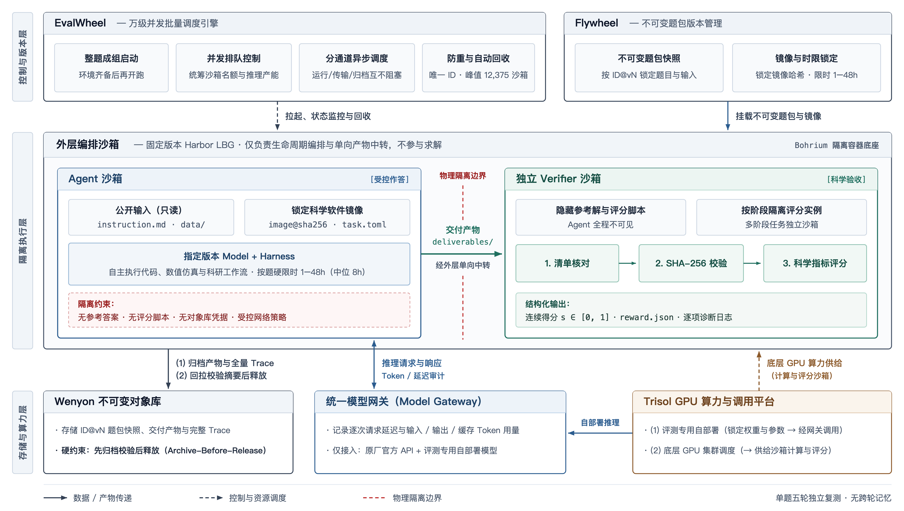

<h3>面向真实科研场景的大模型与智能体能力开放评测平台</h3>

  <em>真实问题，科学尺度，让 AI 的进步走进科学的进展。</em>

  
  
  
  

  <a href="./README.md">English</a> | <strong>简体中文</strong>

---

## 项目简介

**DeltaScience** 是**面向真实科研场景的大模型与智能体能力开放评测平台**，致力于**连接前沿科学探索与真实产业研发，用真正值得解决的问题，检验 AI 的科研能力**。

名称中的符号 **$\delta$** 既象征可复测、可追溯的**科学能力增量**，也代表评测集与 AI 科研能力的**持续进化**。DeltaScience 面向完整的 **Model + Harness** 系统，在隔离科研沙箱中检验其能否独立完成真实科研工作流，并交付经得起复现与定量科学验收的代码、数值场、分子设计或跨队列多组学论证。

> **公益与非营利属性**：DeltaScience 为**公益性、非营利**的科研评测项目；非公开评测集不对外销售、不进行商业转让、不用于模型训练、不做商业变现。

### DeltaScience v1.0 核心特点

- **65 道来自一线的非公开真实任务**：覆盖 **7 大学科大类**、**35 个细分类别**与 **4 类互斥题型**，其中 **29 道（44.6%）**横跨两个及以上学科大类。
- **五轮独立沙箱实测**：首期共评测 **11 个锁定版本的 Model + Harness 组合**，每题独立运行 **5 轮**（共 **3,575 次**正式评测，含预检与对照复测累计超万次沙箱运行），单题时限 **1–48 小时**（中位 **8 小时**）。
- **入选题目确权（CSTR）**：DeltaScience 为**所有入选题目**提供**中国科技资源标识（CSTR）**——由中国科学院计算机网络信息中心建设运营，根据国家标准《科技资源标识》建立的科技资源统一标识体系，为各类科技资源提供全球唯一、长期有效的标识，实现科技资源全球范围快速定位与获取。
- **双轨持续演进**：已发布版本（如 `v1.0`）保持题包快照（`ID@vN`）不变，支持模型与 Harness 团队升级后同题复测验证真实增量 $\delta$；同时通过**月度版本化发布**与**批次专家审题**持续纳入新题，并将趋于饱和的题目逐步开源至社区。

---

## 官方评测网站与核心入口

| 资源项 | 链接 | 说明 |
| :--- | :--- | :--- |
| **官方平台与公开榜单** | [https://deltascience.bohrium.com/](https://deltascience.bohrium.com/) | 查看 v1.0 首期总榜、分学科画像、公开例题及申请接入评测 |
| **Playground 出题竞赛与常年征题** | [https://play.bohrium.com/competition/science-pilot](https://play.bohrium.com/competition/science-pilot) | 提交真实科研与产业难题，入选获 CSTR 标识、集体署名与竞赛激励 |
| **开源题目仓库** | [https://github.com/deepmodeling/DeltaScience](https://github.com/deepmodeling/DeltaScience) | 首批开源代表题包（Harbor 格式）、题目说明与验收规范 |
| **官方联系邮箱** | [deltascience@aisi.ac.cn](mailto:deltascience@aisi.ac.cn) | 模型与 Harness 评测对接、科研机构共建与社区合作 |

---

## 首批开源代表题目（7 道）

为防止数据污染，v1.0 主体 65 道题在活跃期内保持非公开；本仓库同步开源 **7 道各领域高质量代表题目**，方便学术界与产业界了解标准 Harbor 题包结构、独立评分器设计与科学验收口径：

| 中国科技资源标识（CSTR） | 学科大类 | 题目主题 | 题型 | 时限 | 题包目录 | 官网详情 |
| :--- | :--- | :--- | :--- | :---: | :---: | :---: |
| [`31254.49.DELTASCIENCE.V1.C.03`](https://cstr.cn/31254.49.DELTASCIENCE.V1.C.03) | 化学、生命科学 | **BCL2 / BCL-XL 选择性分子设计**：优先保留 BCL2 的多样分子组合 | 开放式设计与搜索 | 5h | [查看目录](./tasks/C-03/) | [官网](https://deltascience.bohrium.com/questions/C-03) |
| [`31254.49.DELTASCIENCE.V1.R.DAN.12`](https://cstr.cn/31254.49.DELTASCIENCE.V1.R.DAN.12) | 化学 | **Danicopan 系列 `DAN-US2019-EX395`**：开放路线逆合成与多路线排序 | 工具调用与路线规划 | 8h | [查看目录](./tasks/R-DAN-12/) | [官网](https://deltascience.bohrium.com/questions/R-DAN-12) |
| [`31254.49.DELTASCIENCE.V1.O03`](https://cstr.cn/31254.49.DELTASCIENCE.V1.O03) | 生命科学 | **结节性痒疹成纤维细胞病理状态**：9 阶段跨队列发现与多组学验证 | 多阶段数据分析与论证 | 8h | [查看目录](./tasks/O03/) | [官网](https://deltascience.bohrium.com/questions/O03) |
| [`31254.49.DELTASCIENCE.V1.QI.0002`](https://cstr.cn/31254.49.DELTASCIENCE.V1.QI.0002) | 物理学、数学与计算机 | **噪声适配量子编码与恢复电路**：受限电路的门误差容忍度优化 | 开放式设计与搜索 | 12h | [查看目录](./tasks/QI-0002/) | [官网](https://deltascience.bohrium.com/questions/QI-0002) |
| [`31254.49.DELTASCIENCE.V1.FUS.0001`](https://cstr.cn/31254.49.DELTASCIENCE.V1.FUS.0001) | 物理学 | **托卡马克自由边界平衡求解**：MAST-U 放电 45425 全部 212 个时刻 | 数值仿真与计算 | 4h | [查看目录](./tasks/FUS-0001/) | [官网](https://deltascience.bohrium.com/questions/FUS-0001) |
| [`31254.49.DELTASCIENCE.V1.T14`](https://cstr.cn/31254.49.DELTASCIENCE.V1.T14) | 材料科学、数学与计算机 | **稳健选择性释放的联合优化**：陷阱取向与工艺控制协同设计 | 开放式设计与搜索 | 1h | [查看目录](./tasks/T14/) | [官网](https://deltascience.bohrium.com/questions/T14) |
| [`31254.49.DELTASCIENCE.V1.LH.1`](https://cstr.cn/31254.49.DELTASCIENCE.V1.LH.1) | 物理学 | **仿星器准轴对称边界优化**（`PRECISE_QA`） | 开放式设计与搜索 | 24h | [查看目录](./tasks/LH-1/) | [官网](https://deltascience.bohrium.com/questions/LH-1) |

标准题包结构说明详见 [`tasks/README_zh.md`](./tasks/README_zh.md)。

---

## DeltaScience v1.0 首期榜单

全部 11 个锁定版本的 **Model + Harness** 组合在 65 道非公开任务上独立完成 5 轮隔离评测（共 3,575 次）。单题取五轮均值后对 65 题等权平均，采用 5,000 次按题配对重采样计算 95% 置信区间；超时、拒答与 Harness 异常均记 0 分。

| 排名 | Model + Harness | 均分 | 95% 区间 | pass@5 | pass⁵ | 中位用时 |
| :-: | :--- | :-: | :-: | :-: | :-: | :-: |
| 1 | **GPT-6.2 Astra + Codex** | **61.2** | [51.2, 70.6] | 44.6% | 30.8% | 42m |
| 2 | **GPT-6.2 Sol + Codex** | **56.1** | [46.8, 65.1] | 36.9% | 21.5% | 35m |
| 3 | **Qwen4-Max + Qoder** | **44.0** | [35.2, 52.9] | 38.5% | 13.8% | 176m |
| 4 | **Kimi K3.1 Pro + Kimi Code** | **40.8** | [32.4, 49.3] | 34.4% | 12.5% | 150m |
| 5 | **HY4 + DSH** | **38.6** | [30.2, 47.2] | 36.9% | 4.6% | 148m |
| 6 | DeepSeek V4.1 Flash 1017 + DSH | 32.3 | [25.1, 39.9] | 32.3% | 3.1% | 191m |
| 7 | HY4 + CodeBuddy | 27.3 | [20.5, 34.8] | 26.2% | 4.6% | 172m |
| 8 | GLM 5.3 + ZCode | 23.8 | [17.4, 30.4] | 24.6% | 3.1% | 300m |
| 9 | HY4 Flash + CodeBuddy | 22.2 | [16.5, 28.4] | 18.5% | 1.5% | 114m |
| 10 | MiMo V2.6 Pro + MiMo Code | 20.5 | [14.3, 27.1] | 13.8% | 3.1% | 159m |
| 11 | Doubao Seed 2.1 Pro + TRAE | 19.8 | [14.0, 26.1] | 18.5% | 1.5% | 300m |

  

---

## 三层解耦治理与基础设施

DeltaScience 采用**标准制定、社区征题与算力执行三层解耦治理架构**：

1. **DeltaScience Benchmark（独立标准制定与版本发布主体）**：由**北京科学智能研究院**牵头，坚持非营利与学术中立原则，统筹科学验收标准、领域专家批次审题录用与固定版本发布。
2. **Playground（社区征题、竞赛与激励通道）**：承接全球科研与产业社区的任务投稿、常年出题竞赛（[play.bohrium.com/competition/science-pilot](https://play.bohrium.com/competition/science-pilot)）与社区激励。
3. **玻尔科学平台（Bohrium）**：提供算力资源与隔离沙箱评测执行环境，依托 **Flywheel**（不可变题包版本 `ID@vN`）、**EvalWheel**（峰值 12,375 沙箱并发调度）、**Wenyon**（全量产物与 Trace 不可变归档）与 **Trisol**（底层 GPU 算力与调用平台），将学术公信力与技术执行彻底分离。

  

---

## 联合共建机构

- 北京科学智能研究院（AI for Science Institute, Beijing）
- 深势科技（DP Technology）
- 北京大学（Peking University）
- 浙江大学（Zhejiang University）
- 东京大学（University of Tokyo）
- 剑桥大学（University of Cambridge）
- 中国科学院物理研究所（Institute of Physics, Chinese Academy of Sciences）
- 北京航空航天大学（Beihang University）

---

## 合规与防污染声明

- **严禁训练与防污染**：任何机构或个人**不得将评测集题目（含本仓库开源代表题目、题面、参考方案与评分脚本）及其改写、翻译、变体用于训练、微调、蒸馏任何模型，或用于生成合成训练数据**；不得批量爬取、商业销售或用于营利活动。
- **榜单成绩理解边界**：榜单成绩反映特定模型在特定工具链（Harness）、参数配置、运行环境与时间点下的有限轮次评测结果；大模型输出具有随机性，结果不构成商业背书。
